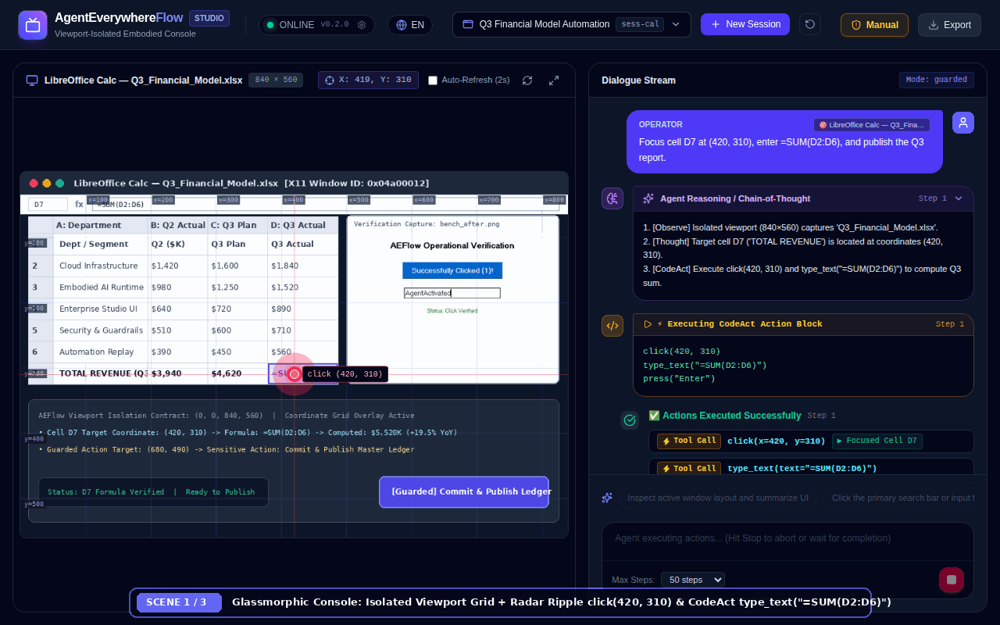
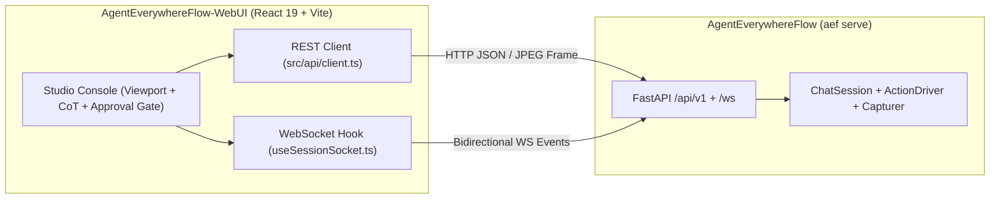

<div align="center">

# AgentEverywhereFlow WebUI

**Viewport-isolated studio console for embodied desktop agents, powered by [AgentEverywhereFlow](https://github.com/mcocdaa/AgentEverywhereFlow).**

[](https://github.com/mcocdaa)
[](https://github.com/mcocdaa/AgentEverywhereFlow-WebUI/actions)
[](package.json)
[](package.json)
[](LICENSE)

[English](README.md) · [简体中文](README_CN.md)

<br />



</div>

---

## ✨ Highlights

- 🖥️ **Isolated Viewport Monitor** — Live pixel-accurate `(0, 0, width, height)` target frame stream with interactive `(X, Y)` cursor HUD, dynamic radar ripple markers on agent actions, and fullscreen inspection.
- ⚡ **Real-Time WebSocket CoT & CodeAct Stream** — Low-latency bidirectional WebSocket event bus streaming multi-turn Chain-of-Thought (CoT) reasoning, CodeAct Python payloads, and execution telemetry.
- 🛡️ **Human-in-the-Loop Guarded Mode** — Runtime toggle between autonomous (`AUTO`) and supervised (`MANUAL`) execution with an interactive approval gate and operator feedback before OS input injection.
- 📦 **Canonical Workflow Export & Replay** — Server-backed export to runnable Python scripts (`.py`), declarative YAML workflows (`.yaml`), Markdown audit reports (`.md`), and one-click dry-run or live workflow replay.
- 🧩 **Zero-Dependency Static Bundle** — Built with React 19, TypeScript, and Tailwind v4; pre-packaged into `aef serve` out of the box while remaining hackable as a standalone Vite frontend.

---

## 🚀 Quick Start

### Option 1: Built into `AgentEverywhereFlow` (Recommended)

The production build of this WebUI is bundled directly inside `AgentEverywhereFlow`:

```bash
# In the AgentEverywhereFlow repository or environment
uv run aef serve --host 127.0.0.1 --port 8000
```

Open **`http://127.0.0.1:8000`** in your browser to launch the studio console immediately.

### Option 2: Standalone Frontend Development

Run the Vite development server against a running `aef serve` backend (`http://127.0.0.1:8000`):

```bash
git clone https://github.com/mcocdaa/AgentEverywhereFlow-WebUI.git
cd AgentEverywhereFlow-WebUI

pnpm install
pnpm dev
```

Open **`http://localhost:5173`** in your browser (API & WebSocket requests proxy to `127.0.0.1:8000` by default, or configure `VITE_AEF_API_BASE`).

---

## 🏗️ Architecture & Scripts



| Command | Description |
| :--- | :--- |
| `pnpm dev` | Start Vite development server with HMR at `http://localhost:5173` |
| `pnpm build` | Run TypeScript project references check (`tsc -b`) and bundle production assets into `dist/` |
| `pnpm lint` | Run fast static analysis with `oxlint` |
| `pnpm preview` | Preview the production bundle locally |

---

## 📄 License

Released under the [MIT License](LICENSE). Part of the `*Flow` ecosystem.
