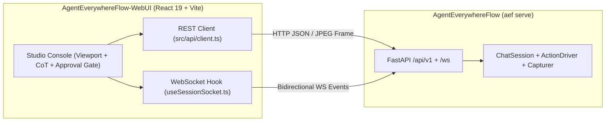

<div align="center">

# AgentEverywhereFlow WebUI

**基于 [AgentEverywhereFlow](https://github.com/mcocdaa/AgentEverywhereFlow) 的具身桌面智能体视口隔离控制台与审批工作台。**

[](https://github.com/mcocdaa)
[](https://github.com/mcocdaa/AgentEverywhereFlow-WebUI/actions)
[](package.json)
[](package.json)
[](LICENSE)

[English](README.md) · [简体中文](README_CN.md)

<br />


</div>

---

## ✨ 核心特性

- 🖥️ **隔离视口实时监控（Isolated Viewport Monitor）** — 严格对齐目标窗口/屏幕 `(0, 0, width, height)` 局部坐标契约的实时画面流，内置 `(X, Y)` 鼠标悬停坐标 HUD、动作落点动态雷达波纹标记及全屏检视。
- ⚡ **实时 WebSocket 思维链与动作流（CoT & CodeAct Stream）** — 基于低延迟双向 WebSocket 事件总线，实时流式呈现多轮思维链（CoT）推理、CodeAct Python 代码载荷与执行遥测状态。
- 🛡️ **人机协同安全审批门控（Human-in-the-Loop Guarded Mode）** — 支持运行时无缝切换全自动（`AUTO`）与人工监督（`MANUAL`）模式，在注入底层操作系统点击/按键动作前拦截并支持审批或注入纠偏反馈。
- 📦 **标准工作流导出与一键回放（Workflow Export & Replay）** — 原生对接后端接口导出可独立运行的 Python 脚本（`.py`）、声明式 YAML 工作流（`.yaml`）与 Markdown 审计报告（`.md`），并支持一键 Dry-Run 演练或真实回放。
- 🧩 **零依赖静态产物内嵌（Zero-Dependency Static Bundle）** — 基于 React 19、TypeScript 与 Tailwind v4 构建，生产静态包直接内嵌于 `aef serve` 开箱即用，同时支持独立 Vite 前端开发调试。

---

## 🚀 快速开始

### 方式一：通过 `AgentEverywhereFlow` 内置服务启动（推荐）

本 WebUI 的生产构建产物已直接内置于 `AgentEverywhereFlow` 核心库中：

```bash
# 在 AgentEverywhereFlow 仓库或已安装环境中执行
uv run aef serve --host 127.0.0.1 --port 8000
```

在浏览器打开 **`http://127.0.0.1:8000`** 即可直接使用完整控制台。

### 方式二：独立前端开发调试

在已启动 `aef serve` 后端服务（`http://127.0.0.1:8000`）的前提下启动本地 Vite 开发服务器：

```bash
git clone https://github.com/mcocdaa/AgentEverywhereFlow-WebUI.git
cd AgentEverywhereFlow-WebUI

pnpm install
pnpm dev
```

在浏览器打开 **`http://localhost:5173`**（API 与 WebSocket 请求默认连接至 `127.0.0.1:8000`，也可通过 `VITE_AEF_API_BASE` 自定义）。

---

## 🏗️ 架构与构建命令



| 命令 | 说明 |
| :--- | :--- |
| `pnpm dev` | 启动 Vite 热更新开发服务器（`http://localhost:5173`） |
| `pnpm build` | 执行 TypeScript 类型检查（`tsc -b`）并打包生产静态资源至 `dist/` |
| `pnpm lint` | 使用 `oxlint` 执行静态代码检查 |
| `pnpm preview` | 在本地预览生产环境构建产物 |

---

## 📄 开源协议

基于 [MIT License](LICENSE) 开源，隶属于 `*Flow` 生态家族。
